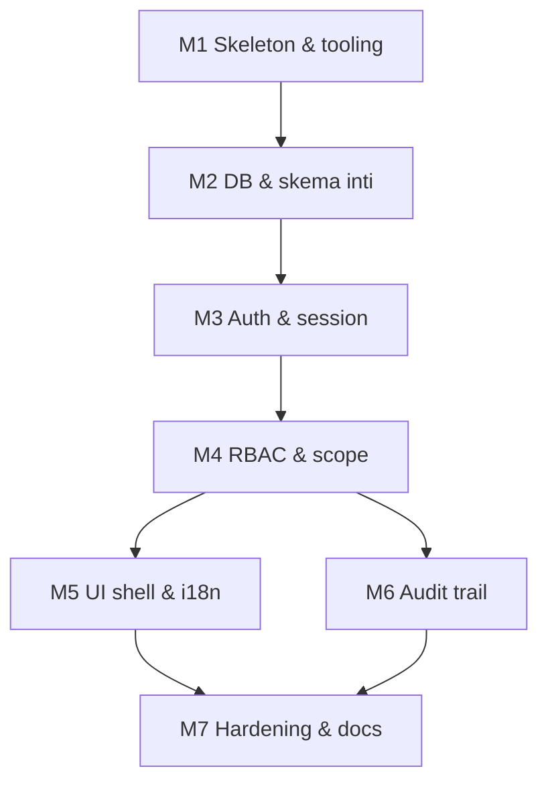

# PLAN-0001 — Implementasi Fondasi Proyek

| Atribut | Nilai |
|---|---|
| ID | PLAN-0001 |
| Issue | ISSUE-0001 (disetujui 2026-01-30) |
| Spec | SPEC-0001 (approved 2026-01-30) |
| Status | `APPROVED` — 2026-01-30 |
| Tanggal | 2026-01-30 |

## 1. Tujuan Plan

Menghasilkan fondasi aplikasi yang **dapat dijalankan, teruji, dan aman**: Next.js + PostgreSQL berjalan
via Docker, autentikasi & RBAC terpusat berfungsi, i18n ID/EN aktif, dan audit trail append-only
terpasang — sehingga ISSUE-0002a dapat langsung dikerjakan di atasnya.

## 2. Milestone

| # | Milestone | Deliverable | Kriteria Selesai |
|---|---|---|---|
| **M1** | Skeleton & tooling | Next.js + TS strict, Tailwind, shadcn, ESLint/Prettier, Vitest, Playwright, scripts | `npm run dev`, `build`, `typecheck`, `lint` lulus |
| **M2** | Database & skema inti | Docker Compose Postgres, Prisma schema (Plant, User, UserRole, Session, AuditLog), migrasi, trigger append-only, seed | `migrate deploy` + `db:seed` sukses; trigger menolak UPDATE/DELETE |
| **M3** | Auth & session | argon2id, login/logout, rate limit, lockout, cookie session DB, `/api/me` | Integration test login sukses/gagal/lock/rate limit lulus |
| **M4** | RBAC & scope plant | `permissions.ts`, `requirePermission()`, `can()`, guard layout `(app)` | Test matriks 120 kasus lulus; halaman terlarang → 403 |
| **M5** | UI shell & i18n | Sidebar/topbar/breadcrumb, halaman login, dashboard, audit, profile; next-intl ID/EN + switcher | AC6 lulus; tidak ada string hardcode (ESLint rule) |
| **M6** | Audit trail | `writeAudit()`, halaman audit read-only + filter | AC7–AC8 lulus |
| **M7** | Hardening & docs | Security headers, healthcheck, `.env.example`, README setup | AC10 lulus; E2E hijau di CI |

## 3. Urutan Pengerjaan

> M5 dan M6 dapat dikerjakan paralel setelah M4.

## 4. Pemecahan Task (ringkas)

| # | Task | Milestone | Dependensi | Est. |
|---|---|---|---|---|
| 1 | Init Next.js 15 + TS strict + path alias | M1 | — | 0.25 h |
| 2 | Tailwind v4 + shadcn/ui init + tema dasar | M1 | 1 | 0.25 h |
| 3 | ESLint + Prettier + rule `no-literal-string` | M1 | 1 | 0.25 h |
| 4 | Vitest + Playwright + script `test`, `test:e2e` | M1 | 1 | 0.25 h |
| 5 | `docker-compose.yml` (postgres) + `.env.example` | M2 | 1 | 0.25 h |
| 6 | Prisma init + schema inti (5 model) | M2 | 5 | 0.5 h |
| 7 | Migrasi awal + trigger append-only `audit_logs` | M2 | 6 | 0.5 h |
| 8 | Prisma client singleton + seed idempotent | M2 | 7 | 0.5 h |
| 9 | `password.ts` (argon2id + policy) | M3 | 6 | 0.25 h |
| 10 | `session.ts` (buat/validasi/revoke, hashing token) | M3 | 8 | 0.5 h |
| 11 | `rate-limit.ts` + lockout logic | M3 | 9 | 0.25 h |
| 12 | `POST /api/auth/login`, `/logout`, `GET /api/me` | M3 | 10, 11 | 0.5 h |
| 13 | `permissions.ts` (matriks 20×6) | M4 | 8 | 0.5 h |
| 14 | `guard.ts` (`requirePermission`, scope plant) | M4 | 13 | 0.5 h |
| 15 | Guard di `(app)/layout.tsx` + middleware | M4 | 14 | 0.25 h |
| 16 | next-intl config + `messages/id.json`, `en.json` | M5 | 1 | 0.5 h |
| 17 | Halaman login + form + error state | M5 | 12, 16 | 0.5 h |
| 18 | Shell: sidebar/topbar/breadcrumb + language switcher | M5 | 16 | 0.5 h |
| 19 | Halaman dashboard + profile | M5 | 18 | 0.25 h |
| 20 | `writeAudit()` + panggilan di login/CRUD | M6 | 10 | 0.5 h |
| 21 | `GET /api/audit` + halaman audit (filter, read-only) | M6 | 20 | 0.5 h |
| 22 | Security headers + `/api/health` | M7 | 15 | 0.25 h |
| 23 | README + docs setup + skrip | M7 | — | 0.25 h |
| 24 | Test unit `can()` 120 kasus + password/session | M7 | 13, 10 | 0.5 h |
| 25 | Integration auth + trigger append-only | M7 | 12, 7 | 0.5 h |
| 26 | E2E login → dashboard → ganti bahasa → logout; akses 403 | M7 | 17, 18 | 0.5 h |

**Total estimasi: ± 10 jam kerja efektif (≈ 2 hari fokus, buffer menjadi 3–4 hari).**

## 5. Dampak & Perubahan yang Diharapkan

**File/folder baru:**
- `src/app/**` (route group `(auth)`, `(app)`, `api`)
- `src/server/{auth,authz,audit,db,i18n}/**`
- `src/components/{ui,layout,shared}/**`
- `src/messages/{id,en}.json`
- `prisma/{schema.prisma,migrations/,seed.ts}`
- `tests/{unit,integration,e2e}/**`
- `docker-compose.yml`, `.env.example`, `README.md`

**Migrasi DB:** 1 migrasi awal (5 tabel + enum + trigger append-only).

**Breaking change:** tidak ada (greenfield).

## 6. Strategi Pengujian

1. Setiap milestone menutup dengan test terkait (tidak menunggu M7).
2. Urutan gate: `typecheck` → `lint` → `unit` → `integration` → `e2e`.
3. **Definition of Done tiap task:** kode + test + tidak menurunkan coverage modul terkait.
4. Verifikasi AC issue satu per satu di M7 sebelum ditutup.

## 7. Risiko Pelaksanaan

| Risiko | Mitigasi |
|---|---|
| Retrofitting i18n karena string hardcode | ESLint rule aktif sejak M1 |
| Trigger append-only bentrok dengan Prisma (mis. `updatedAt`) | `AuditLog` tanpa `updatedAt`; test raw SQL |
| Testcontainers/Docker tidak tersedia di mesin dev | Fallback: Postgres lokal via compose + `DATABASE_URL` env |
| argon2 native build gagal di Windows | Fallback `@node-rs/argon2` (prebuilt binary) |

## 8. Rollback Plan

Greenfield: hapus volume Docker + `prisma migrate reset`. Tidak ada data produksi yang berisiko.

## 9. Estimasi Total

**2 hari fokus** (buffer 3–4 hari). Kompleksitas **L**.

## 10. Gerbang

- [x] **Review user disetujui** — 2026-01-30 → `docs/todo/TODO-0001.md`

