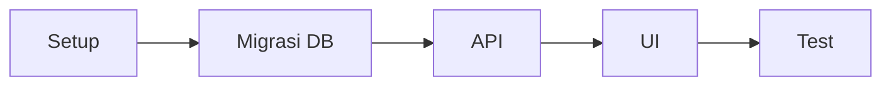

# PLAN-XXXX — {Judul} (turunan dari ISSUE-XXXX / SPEC-XXXX)

| Atribut | Nilai |
|---|---|
| ID | PLAN-XXXX |
| Issue | ISSUE-XXXX |
| Spec | SPEC-XXXX |
| Status | `DRAFT` → `REVIEW` → `APPROVED` |
| Tanggal | YYYY-MM-DD |

## 1. Tujuan Plan
Apa yang akan tercapai di akhir plan ini.

## 2. Milestone
| # | Milestone | Hasil (deliverable) | Kriteria selesai |
|---|---|---|---|
| M1 |  |  |  |
| M2 |  |  |  |

## 3. Urutan Pengerjaan

## 4. Pemecahan Task (ringkas)
| # | Task | Milestone | Dependensi | Estimasi |
|---|---|---|---|---|
| 1 |  | M1 | — | — |

> Detail atomik ditulis di `docs/todo/TODO-XXXX.md`.

## 5. Dampak & Perubahan yang Diharapkan
- File/folder baru:
- File yang diubah:
- Migrasi DB:
- Breaking change:

## 6. Strategi Pengujian
Urutan dan cakupan test yang dijalankan sebelum dianggap selesai.

## 7. Risiko Pelaksanaan
| Risiko | Mitigasi |
|---|---|
|  |  |

## 8. Rollback Plan
Cara membatalkan bila hasil tidak memenuhi kriteria.

## 9. Estimasi Total
— hari kerja (— sprint)

## 10. Gerbang
- [ ] **Review user disetujui** → lanjut ke `docs/todo/TODO-XXXX.md`
